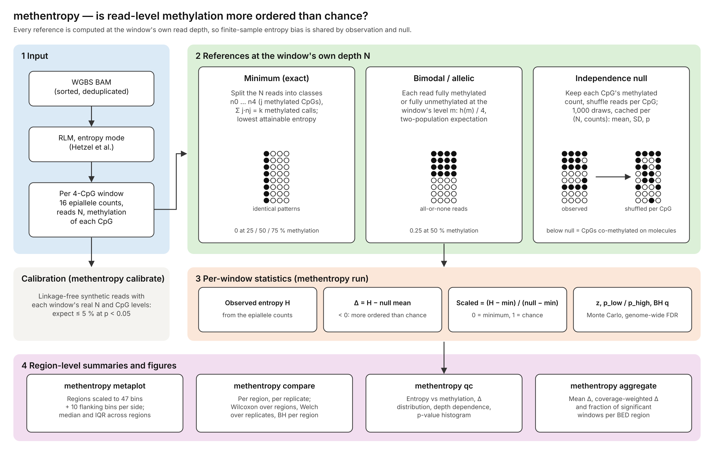

# methentropy

**Author:** Meiying Cui ([@mc3365](https://github.com/mc3365)), Yale University

Depth-matched null models for 4-CpG methylation entropy computed by
[RLM](https://github.com/sarahet/RLM) from bisulfite sequencing data.

[](docs/figures/methentropy_workflow.png)

**Question addressed:** is the methylation entropy of a region explained by its
methylation level and read depth alone, or are CpGs on the same molecule more
(or less) coordinated than chance?

Version 3 is a rewrite of the earlier `rlm_simulation` pipeline (v1) and the
`methylation-entropy-simulation` package (v2). The main changes:

| | v1 / v2 | v3 |
|---|---|---|
| Read depth used for references | fixed (16 for minimum, 128 for simulation) | each window's own RLM coverage |
| Stochastic null | all 4N calls pooled and shuffled | each CpG keeps its own methylation count; reads shuffled independently per CpG |
| Minimum entropy | nearest key in a 16-read lookup | exact, at the window's (N, k) |
| "Allelic" reference | the mathematical minimum (0 at 50%) | separate `entropy_bimodal` (all-or-none reads) |
| Output statistic | 5th–95th percentile band | delta, z, scaled entropy, Monte Carlo p-values, BH q-values |
| Reproducibility | none / per-run seed | per-key seeds: identical results for any worker or chunk count |

In a linkage-free synthetic test (independent CpGs, 10–60 reads per window),
the v1/v2 rule labelled ~95% of windows "below stochastic" while v3 flagged
~3.5% at p < 0.05. Run `methentropy calibrate` to check this on your own data. See [docs/methods.md](docs/methods.md).

## Install

Python ≥ 3.9, numpy and pandas only.

```bash
git clone <this repo> methentropy
cd methentropy
python -m pip install -e .            # in your conda env on the cluster
python -m pip install -e '.[dev]' && pytest   # optional: run the tests
```

## Input

The **full RLM entropy output** (`RLM -s entropy` or `-s all`, file given by
`-e/--output_entropy`): 23 tab-separated columns, `#chr` header, plain or `.gz`:

```text
#chr start end entropy epipolymorphism gggg gggG ... GGGG mean_methylation coverage
```

The 16 epiallele counts are what make depth-matching and the per-CpG null
possible. Legacy 5-column files (`chrom start end entropy methylation`, as used
by v1/v2) are accepted only with `--legacy-coverage N` and get the pooled null
at that assumed depth; this reproduces the old analysis and is not depth-matched.

## Usage

```bash
# 1. sanity check: is the test calibrated on this sample's depths/levels?
methentropy calibrate -i mef_p0_entropy.bed.gz --windows 2000

# 2. genome-wide run (uses $SLURM_CPUS_PER_TASK workers if set)
methentropy run -i mef_p0_entropy.bed.gz -o mef_p0_methentropy.tsv.gz \
    --nsims 1000 --seed 1 --min-coverage 10

# 3. summarise over features (BED: chrom start end [name])
methentropy aggregate -i mef_p0_methentropy.tsv.gz -r dmvs.bed -o mef_p0_dmvs.tsv

# exact minimum / bimodal references for given depths (replaces create_lookup*.py)
methentropy lookup --nreads 16 32 128 -o min_entropy_lookup.tsv
```

`scripts/slurm_methentropy.sh` is a SLURM template for several passages.

## Figures

Needs matplotlib and scipy: `pip install -e '.[plot]'`.

```bash
# metaplot over scaled regions (v1 design), replicates averaged per condition
methentropy metaplot \
    -s "Unpassaged=p_1_1.tsv.gz,p_1_2.tsv.gz,p_1_3.tsv.gz" \
    -s "Passage 0=p0_1.tsv.gz,p0_2.tsv.gz,p0_3.tsv.gz" \
    -s "Passage 5=p5_1.tsv.gz,p5_2.tsv.gz,p5_3.tsv.gz" \
    -r DMVs_label.bed --names hyper_dmvs.txt --region-label DMV \
    --title "Hyper DMVs" -o figs/hyper_dmv

# per-sample QC
methentropy qc -i p5_1.tsv.gz -o figs/p5_1
```

`metaplot` writes `<prefix>_metaplot.{png,pdf}` (one row per condition:
observed, stochastic null, bimodal, minimum, methylation; and observed − null),
`<prefix>_delta_overlay.{png,pdf}` (observed − null of all conditions on one
axis) and `<prefix>_profile.tsv` (the plotted numbers). Regions are scaled to
`--body-bins` (47) with `--flank` (2 kb) in `--bin-size` (200 bp) bins on both
sides, matching EnrichedHeatmap `extend = 2000, w = 200, target_ratio = 0.7`.
`--names` keeps regions whose `--name-column` (default 4) is listed in a file.

`compare` tests conditions region by region, with replicates kept separate:

```bash
methentropy compare \
    -s "Unpassaged=p_1_1.tsv.gz,p_1_2.tsv.gz,p_1_3.tsv.gz" \
    -s "Passage 0=p0_1.tsv.gz,p0_2.tsv.gz,p0_3.tsv.gz" \
    -s "Passage 5=p5_1.tsv.gz,p5_2.tsv.gz,p5_3.tsv.gz" \
    -r DMVs_label.bed --names hyper_dmvs.txt --region-label DMV -o figs/hyper_dmv
```

Per region and replicate it averages observed − null and computes the scaled
entropy (sum-based, so near-zero-variance windows do not dominate). Every
condition is compared with the first: paired Wilcoxon over regions, Welch over
replicate means (the conservative test with n = replicates), and per-region
Welch tests with BH. Outputs: `<prefix>_summary.tsv`, `<prefix>_regions.tsv`,
`<prefix>_compare.{png,pdf}`.

`qc` writes `<prefix>_qc.png` and `<prefix>_qc_summary.tsv`: entropy vs
methylation with the references, the distribution of observed − null, observed −
null by read depth (flat = depth effect removed) and the p-value histogram.
Windows whose null has no spread (e.g. fully methylated) give p = 1, which shows
up as a bar at 1.

## Output of `run`

A worked example of every column, and where each one appears in the figures,
is in [docs/interpreting_output.md](docs/interpreting_output.md).


| column | meaning |
|---|---|
| `coverage` | reads spanning the 4-mer (N) |
| `methylation`, `meth_cpg1..4` | mean and per-CpG methylation from the epiallele counts |
| `entropy` | observed entropy (recomputed; matches RLM) |
| `entropy_min` | exact minimum possible entropy at (N, k methylated calls) |
| `entropy_bimodal` | entropy if every read were GGGG or gggg at this level |
| `null_mean`, `null_sd`, `null_q05`, `null_q95` | independence null at depth N with the observed per-CpG levels |
| `delta` | `entropy - null_mean` (negative = more ordered than chance) |
| `z` | `delta / null_sd` |
| `scaled_entropy` | `(entropy - entropy_min) / (null_mean - entropy_min)`: 0 = minimum, 1 = chance |
| `p_low`, `p_high`, `p_two` | Monte Carlo p-values (lower = co-methylation, higher = excess disorder) |
| `q_two` | Benjamini–Hochberg q-value of `p_two` over the whole file |
| `pooled_*` | only with `--with-pooled`: the v1/v2 null, but at depth N |

## Runtime

Null distributions depend only on (N, folded per-CpG counts), so each distinct
key is simulated once per chunk and shared by all windows with that key. Cost is
roughly 2 ms per key per 1,000 simulations per core; the number of keys is far
smaller than the number of windows because most windows are near 0% or 100%.
Use a larger `--chunksize` (if memory allows) to reuse keys across more windows,
`--max-coverage` to drop very deep repeat windows, and `--nsims 500` for a
quick pass. The smallest attainable p-value is `1 / (nsims + 1)`.

## Author and credit

The scientific idea behind this tool is by **Meiying Cui**: separating biological
methylation heterogeneity from the entropy expected from methylation level
alone, by placing observed 4-CpG entropy between a theoretical minimum and a
stochastic reference. She designed the test, wrote and optimised the original
implementation (`rlm_simulation`: the exhaustive minimum-entropy lookup, the
fixed-methylation stochastic simulation and its parallel HPC version) and
developed the metaplot visualisation of observed, stochastic and minimum
entropy around genomic features.

Version 3 (depth matching, per-CpG independence null, statistics, packaging)
builds on that design and was developed by Meiying Cui with AI-assisted coding.

If you use this software, please cite it as described in `CITATION.cff`.

## License

MIT License, Copyright (c) 2026 Meiying Cui. See [LICENSE](LICENSE).

## Citation

If you use RLM output, cite Hetzel et al., "RLM: fast and simplified extraction
of read-level methylation metrics from bisulfite sequencing data",
*Bioinformatics* (doi:10.1093/bioinformatics/btab663).
